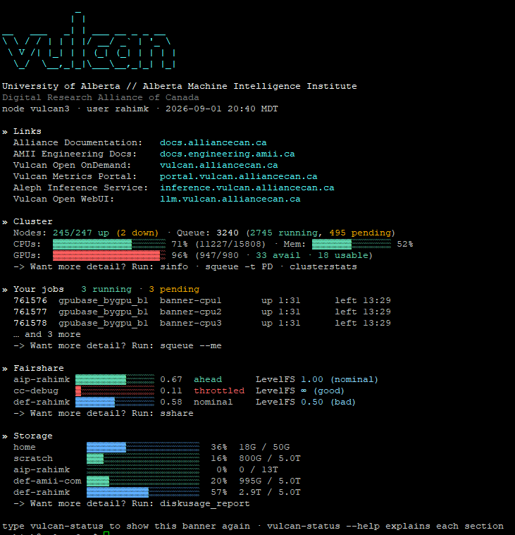

# vulcan-status

## Description

`vulcan-status` is a terminal login banner for Slurm clusters. It shows how busy the cluster is, which of your jobs are running or waiting, and storage use across home, scratch and project filesystems. The defaults follow the layout common on Digital Research Alliance of Canada clusters; other Slurm sites can adjust the storage paths, branding and links in the site configuration.

Run `vulcan-status` to see the banner again without logging back in.

<div align="center">



*Example from the Vulcan cluster.*

</div>

## Reading the banner

- **Cluster and jobs:** Node, queue, CPU, memory and GPU totals normally come from a snapshot refreshed about every ten minutes. Your own job list comes directly from Slurm.
- **GPUs:** `avail` counts unallocated GPUs. A node can have a free GPU but too little CPU or memory left for another GPU job. `usable` estimates how many GPUs have those resources too; it doesn't predict when your job will start.
- **Fairshare:** This is one input to job priority, not the percentage of your allocation you've spent.
- **Storage:** Each row shows what `df` reports for that path: your quota on some filesystems, usage for the entire filesystem on others. Fairshare and storage can be cached privately for up to 15 minutes by default.

Run `vulcan-status --plain --only cluster` for just the cluster section without color, or `vulcan-status --help` to see the banner with explanations. The login hook stays silent during file transfers. Use `~/.hushlogin` or `VULCAN_MOTD_OFF=1` to skip the automatic banner; you can still run it yourself.

## Install on a login node

Requires Bash, GNU coreutils and Slurm client commands. The bundled systemd timer refreshes the cluster snapshot; the login hook checks for an interactive terminal before calling `vulcan-status` to display the banner. From the repository root, install directly or stage the same files in your site's node image:

```bash
sudo install -m 0755 usr/local/bin/vulcan-status /usr/local/bin/
sudo install -m 0755 usr/local/sbin/vulcan-motd-bake /usr/local/sbin/
sudo install -d -m 0755 /etc/vulcan-motd
sudo cp -n etc/vulcan-motd/{motd.conf,announce.txt} /etc/vulcan-motd/
sudo install -m 0644 etc/systemd/system/vulcan-motd-bake.{service,timer} /etc/systemd/system/
sudo systemctl daemon-reload
sudo systemctl enable --now vulcan-motd-bake.timer
sudo systemctl start vulcan-motd-bake.service
sudo install -m 0644 etc/profile.d/zz-vulcan-motd.sh /etc/profile.d/
```

The optional [Vulcan MOTD cleanup playbook](etc/ansible/playbooks/89-motd.yaml) is **not required**. It deletes regular files directly under `/etc/update-motd.d/` unless their names start with `vulcan_`, including site-written notices. Review its `--check` output before opting in.

## Adapt it to your site

Edit `/etc/vulcan-motd/motd.conf` (root-owned: the cache service sources it as shell code). Set `CLUSTER_NAME`, `SITE_TITLE`, `SITE_SUBTITLE`, `LOGO_FILE` and `LINKS_FILE` to replace the default name, branding and links. The logo is plain text; links are one `Label:|https://example.org` per line. Put notices in `announce.txt`; an empty file hides the section. See the [sample config](etc/vulcan-motd/motd.conf) for storage paths, thresholds and cache settings.

## Support

Vulcan cluster support: [Digital Research Alliance of Canada](mailto:support@tech.alliancecan.ca). Repository maintainers: [Rahim Khoja](mailto:khoja1@ualberta.ca) and [Karim Ali](mailto:kali2@ualberta.ca), University of Alberta Research Computing.

[Changelog](CHANGELOG.md) · [MIT License](LICENSE)
